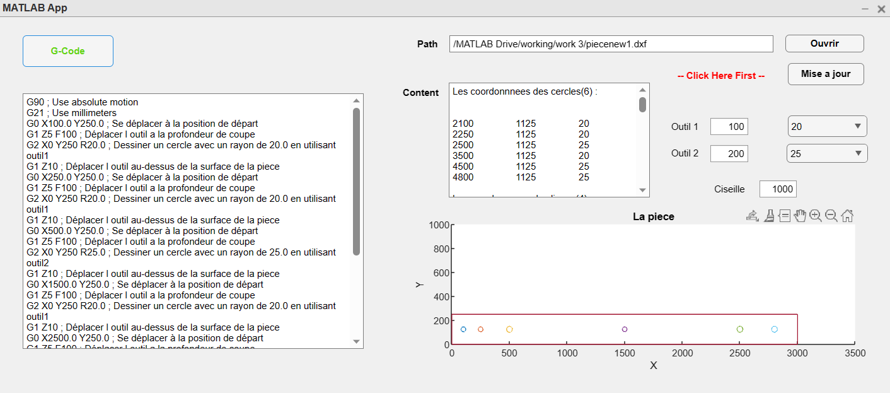

# MatlabCAM

**Turn a flat-part DXF into tool positions and G-code, without leaving MATLAB.**


Open a drawing, tell the app which hole size belongs to which tool, and walk away with a program. Built for anyone who already has the holes in CAD and does not want to retype every center by hand.



```
piecenew1.dxf
      |
      v
 circles + outline -----> tool 1, tool 2, shear
      |                         |
      v                         v
 axes preview            generated_gcode.txt
```

## Why this exists

A DXF full of holes still leaves you copying coordinates into a text editor, or opening a full CAM seat to assign two drills and a shear.

MatlabCAM does that job in one window. It reads the circles and the lines, lets you match each radius to a tool, adds your offsets, draws the part, and writes the G-code next to the numbers you can check.

## Quick start

You need MATLAB. This app was saved in R2023a. The file itself allows R2018a and newer.

```bash
git clone https://github.com/AbdelghaniElaoud/MatlabCAM.git
```

Open `application3.mlapp` in App Designer and run it. The buttons are in French. Here is the whole path on the included sample, [`piecenew1.dxf`](piecenew1.dxf):

1. **Mise a jour** (the red "Click Here First" label). Pick the DXF. The radius menus fill with the hole sizes in the file, and the offsets start at 100, 200, and 1000.
2. Choose which radius is **Outil 1** and which is **Outil 2**. Change the three offsets if the defaults are wrong. **Ouvrir**, pick the same file, then click the axes. The part is drawn under **La piece**.
3. **G-Code**. The program shows up on the left and is written to `generated_gcode.txt`. The parsed numbers land in `points_out.txt`.

## What you get

- Every circle, as center and radius, and every line, as two endpoints, pulled straight out of the DXF.
- Each hole assigned to tool 1 or tool 2 by the radius you picked, then shifted by that tool's offset.
- A shear position (**Ciseille**) at the end of the part, plus the offset you typed.
- Hits ordered along the part, from the right edge, so the program runs in one direction.
- A preview of the holes and the outline before you trust the file.
- A G-code program you can read in the app and edit in any text editor.

On the sample drawing that is 6 holes and 7 lines, radii 20 and 25. The first moves look like this:

```gcode
G90 ; Use absolute motion
G21 ; Use millimeters
G0 X100.0 Y250.0 ; Se déplacer à la position de départ
G1 Z5 F100 ; Déplacer l outil a la profondeur de coupe
G2 X0 Y250 R20.0 ; Dessiner un cercle avec un rayon de 20.0 en utilisant outil1
G1 Z10 ; Déplacer l outil au-dessus de la surface de la piece
```

Absolute mode, millimeters. Each hole rapids in X to its distance from the right edge (including the tool offset), at Y250, plunges to Z5 at feed 100, cuts an arc of the matched radius, and retracts to Z10. The shear does the same plunge, then a linear cut to X100 Y100.

The part origin is the start of the first `LINE` in the file. Part length is that line's run in X. Circles are shifted so that corner sits at zero. The preview is drawn for a part inside 3500 by 1000.

The reader looks for `AcDbCircle` and `AcDbLine` records. Arcs, polylines, splines, and blocks are left alone. Bring a drawing whose holes are circles and whose outline is lines.

## Make it yours

The app is the single file [`application3.mlapp`](application3.mlapp). Fork the repo, change the offsets, the plunge, or the arc move, and open a pull request.

If this saved you a night of retyping coordinates, [star MatlabCAM](https://github.com/AbdelghaniElaoud/MatlabCAM). [Star history](https://star-history.com/#AbdelghaniElaoud/MatlabCAM&Date).

The repository does not ship a license file yet.
